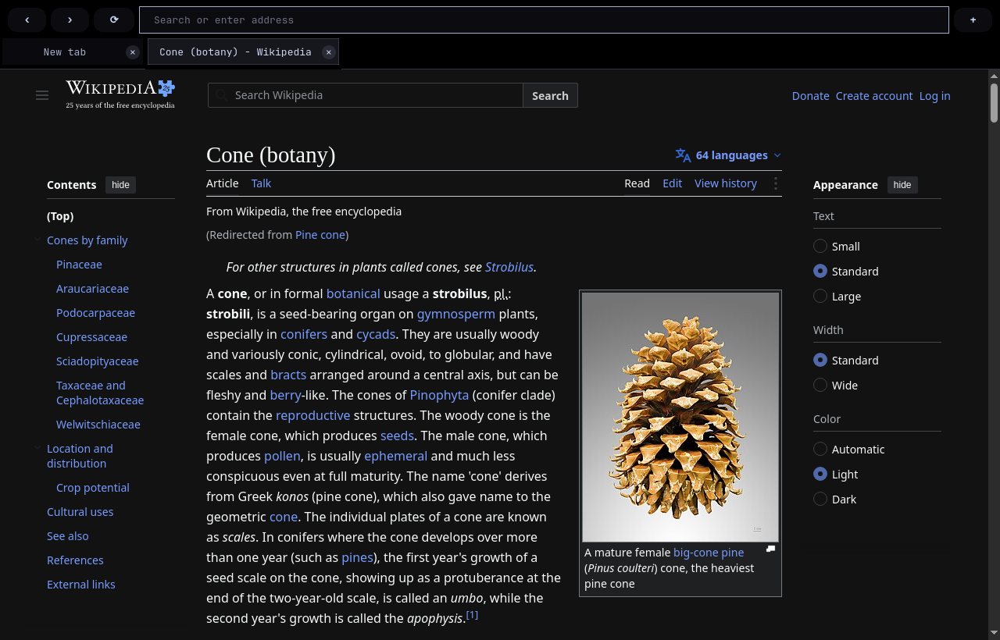
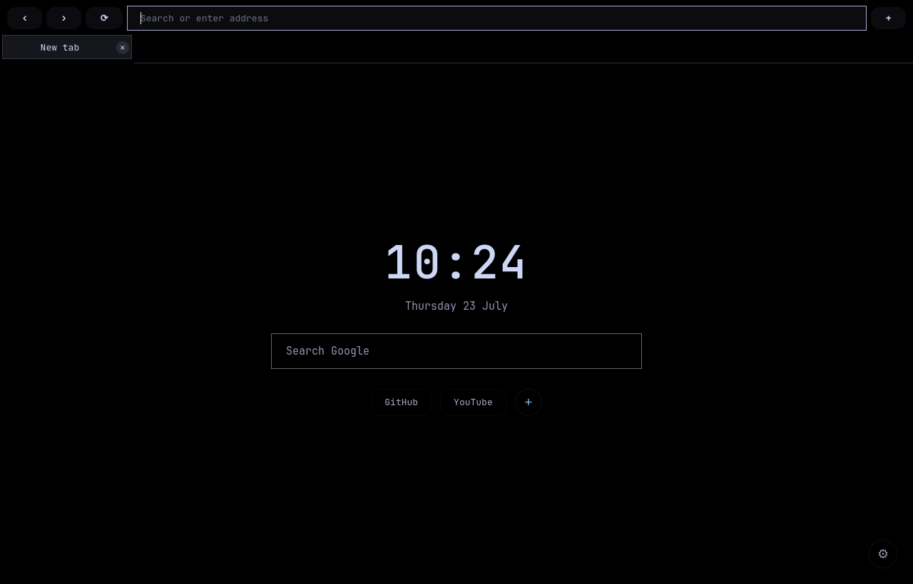

<div align="center">

# browser

**A keyboard-driven web browser in a single Python file — the Windows edition.**

Built on Chromium through Qt WebEngine. 116 themes that recolour the websites as well as
the window, six interface looks, per-site proxy routing, and no telemetry of any kind.

[](LICENSE)
[](https://www.python.org/)
[](https://doc.qt.io/qt-6/qtwebengine-index.html)
[](#overview)
[](#install)



<sub>Wikipedia ships no dark theme of its own; the browser applies one.</sub>

</div>

---

## Overview

- **A single file.** The whole application is `browser.py`. No build step, no plugin
  framework and no dependency tree to audit: edit it, restart, and the change is live.
- **116 themes, applied to the web as well.** Choosing Gruvbox recolours more than the
  tabs: the websites are rendered in the same palette. A single setting turns that off.
- **Six interface looks.** A theme decides what colour the browser is; a look decides
  what shape it is. Classic, Taskbar, Dock, Circle, Liquid Glass and Flat mono, each of
  which works with all 116 palettes.
- **An address bar that computes.** `12*64+3`, `5 in to mm`, `200 c to f`,
  `days until 24.12.`, `time in tokyo`. Everything is evaluated locally; no query leaves
  the machine.
- **Virtual browsers.** Independent sessions within one window, each with its own cookie
  jar, so two accounts on the same site can be signed in at the same time.
- **A password manager that asks which account to use** before filling anything, and
  withholds the stored password from page scripts until the form is genuinely clicked.
  Its file is given an ACL of this user alone, because the POSIX `chmod` used elsewhere
  does nothing on Windows.
- **Per-site proxy routing that fails closed.** A rule pointing at an unreachable proxy
  blocks the site rather than silently connecting directly.
- **No telemetry, no account, no sync.** All data remains in `%LOCALAPPDATA%\browser\`.

## Install

Download this repository (**Code → Download ZIP**), unzip it somewhere permanent, and run
**`install.bat`**.

The installer fetches Python through winget if it is missing, installs PyQt6 WebEngine,
and puts a *Browser* shortcut on the desktop. The shortcut starts the same Python that
pip installed into, which matters on a machine with more than one.

To run it without installing:

```
py -3 browser.py
```

Requirements: Python 3 and PyQt6 WebEngine.

If the desktop shortcut ever loses its icon and stops responding, the folder has been
moved or renamed — run `install.bat` again from its new location to rebuild it.

## A closer look

### 116 themes, and the websites wear them too

Settings → Theme has all 116, searchable, each shown as a swatch of its own colours and
applied on the spot — no restart, and open tabs change with it. 77 are dark, 28 light and
11 bring a face and a texture of their own. Most are credited palettes; the default is
pitch black with [Catppuccin Mocha](https://catppuccin.com/palette/) text.

### Six looks

A theme decides what colour the browser is; a look decides what shape it is. Every look
works with all 116 palettes, because a look defines geometry only and never a colour.

| Look | What it does |
|---|---|
| **Classic** | The browser as it is drawn — the default. |
| **Taskbar** | A strip along the bottom with a start button, the pinned sites and a clock. |
| **Dock** | A floating dock over the page with icon magnification, and a now-playing widget that works the transport of whatever is making the sound. |
| **Circle** | The start page becomes a ring: search in the middle, the quick links orbiting it, turned by the mouse wheel. |
| **Liquid Glass** | Frosted, translucent chrome: the wallpaper shows softly through the tabs, the toolbar and the menus. |
| **Flat mono** | One flat tone, no gradients and no borders — the quietest of the six. |

### Dark by default, not by filter

Sites that ship a dark theme are asked for it. Light-only sites are darkened
automatically. Sites that are already dark are left untouched, which keeps heavy pages
fast.

### A configurable start page



A clock, a search field, editable quick links and background images of your own. The
quick links are the pinned sites: pinning from a page's context menu, from the taskbar's
`+`, or here all write to the same list, and clicking a pin brings its existing tab
forward rather than opening a second one.

## Features

### Browsing

- **Tabs and tab groups** — Chrome-style group pills, collapsible, colour-coded
- **A side panel** (`Ctrl+Shift+Y`) that holds any site beside the page —
  Discord, Amazon Music, Claude, Twitch chat — as a real view on the same
  cookie jar, so it is already logged in
- **Game mode** (`Ctrl+Alt+G`) — every other tab asleep, everything muted,
  notification requests refused; again to wake exactly those tabs
- **Reader mode** (`Ctrl+Alt+R`), **link hints** (`Ctrl+Alt+K`), **read
  aloud** (`Ctrl+Alt+V`) and highlights that come back on the next visit
- **Screenshots** (`Ctrl+Shift+S`, whole page with `Ctrl+Alt+Shift+S`) with
  password fields blurred before the shutter
- **Minecraft server status** (`Ctrl+Alt+J`) — your servers, asked the same
  question the game's own server list asks
- **A command palette** (`Ctrl+Shift+K`) and a **cheat sheet** (`Ctrl+/`);
  every shortcut can be changed in Settings
- **Virtual browsers** — several independent sessions in one window, each with
  its own cookie jar and logins; sign in to the same site twice without
  signing out
- **The address bar answers questions** — `12*64+3`, `5 in to mm`, `200 c to f`,
  `4 gib to mb`, `time in tokyo`, `kw`, `days until 24.12.`, `#ff8800` — all
  worked out on this computer, with nothing sent anywhere. Enter copies the answer
- **Search keywords** — `yt cats`, `mr sodium`, `gh repo`, `amz ssd`, `w term`;
  your own in Settings as any URL with a `%s` in it
- **Suggestions from your own browser** — an open tab (Enter switches to it), a
  bookmark, or a page from your history matched on words in any order; an empty
  bar offers a link you just copied and your last searches
- **Copy clean address** — the same link without `utm_*`, `fbclid` and the rest
  of the tracking, also as a Markdown or HTML link, or "Title — address"
- **Find in page** (`Ctrl+F`) — match count, next/previous, match case
- **Save any image** — right-click → *Save image* works on whatever is drawn
  under the cursor: a picture under an overlay, a CSS background, a canvas,
  an inline SVG. `Shift` + right-click brings the menu up on sites that
  block it
- **Tab search** (`Ctrl+Shift+A`) — every open tab of every virtual browser in
  one filtered list
- **Reopen closed tab** (`Ctrl+Shift+T`) — restores its position and its group,
  and **Recently closed** in the tab menu lists the last 25, not only the last
- **The tab's own menu** — pin (it shrinks to its icon, keeps its place across
  restarts and can be held to its own site), mute (also `Ctrl+M`) or "play
  sound only here", lock so it asks before closing, rename it so the page
  cannot change the title, duplicate it (`Ctrl+Shift+D`), open it in another
  virtual browser or in a private tab, copy the addresses of one tab or of all
  of them (plain or Markdown), open every address in the clipboard, bookmark
  every tab into one folder, sort the tabs by site or title, group or close
  every tab of this site, close the others / to the right / to the left /
  the duplicates
- **Account chooser** (`Ctrl+Shift+M`, or the `@` in the address bar) — two
  accounts saved for a site means nothing is filled in until you say which
  one. The list of accounts is a panel of the browser's own; the page never
  sees it, and never learns what is on it
- **Private tab** (`Ctrl+Shift+N`) — an off-the-record tab that leaves nothing
  behind: no history, no saved password and none offered, no download record,
  no favicon kept, and no cookies or site storage once the last one closes.
  It is never saved as a tab and never comes back at the next start. Two
  private tabs share one place; a normal tab sees none of it
- **Page zoom from the keyboard** — `Ctrl` `+` / `Ctrl+-` / `Ctrl+0`, and
  `Ctrl`+wheel. Per tab, from 25% to 500%; `Ctrl+0` returns to the level in
  Settings. The browser's own pages are not zoomed a tab at a time — they
  follow the Page zoom slider, the way they always have
- **Favourites** (`Ctrl+Shift+F`, or the folder in the toolbar) — the whole
  bookmark collection in one panel, the way Edge's Favourites button works: a
  search box at the top and one list underneath, folders opening in place
  rather than flying out sideways as submenus. Folders go inside folders as
  deep as you like; a new one is named where you make it, renaming happens in
  the row itself, and every row carries its own `⋯` so nothing is hidden
  behind a right-click. Drag a row into a folder, out of one, or between two
  to reorder it — or use **Move to folder** on the `⋯` if dragging is not
  your friend. The bookmarks bar is off unless you ask for it
  (`Ctrl+Shift+B`); the bookmark manager is `Ctrl+Shift+O`
- **Smart address bar** — URLs, search, and live suggestions in one field
- **Fullscreen video**, background tabs, sleeping tabs restored on demand
- **A toolbar you pick** — right-click the row at the top, or Settings →
  Toolbar, to choose which buttons are up there and what order they come in.
  Back, forward, reload and the address bar stay; everything else is yours,
  and eight more buttons that were only ever keyboard shortcuts can join
  them. Taking a button away never touches its shortcut.

### Downloads and printing

- **Download manager** — a downloads page and a toolbar bar with progress,
  speed and time remaining; pause, resume, cancel; history that survives
  restarts
- **Print or save as PDF** (`Ctrl+P`) — the PDF lands in the downloads list
  alongside everything else

### Privacy and security

- **Vault Password** — the built-in password manager. Optional: setup asks
  whether you want it, and Settings → Plugins switches it on or off at any
  time. Off means off — the login watcher is never put into a page, so no
  form is looked at and nothing is ever written to the vault. Switching it
  off deletes nothing; your saved logins are still there when you switch it
  back on. When it is on it offers to save logins and fills them back in on
  a real click, and the saved password is withheld from page scripts until
  you actually interact with the form, so an injected script reads an empty
  field.
- **Per-site proxy routing** — send chosen sites through a proxy while
  everything else goes direct, or the reverse. Rules are enforced by a
  built-in local proxy and fail closed: a rule pointing at a dead proxy
  blocks the site rather than quietly going direct.
- **Site permissions** — microphone, camera and notification requests are
  asked per origin and remembered per origin, scheme and port.
- **History control** — pause it, search it, or clear it
- **Trust boundary** — the browser's own pages get a privileged bridge to the
  application; websites never do, and cannot reach it through the underlying
  channel

### Setup and configuration

- **Setup** — a seven-step first run: language, search engine, start page,
  site behaviour, privacy, quick links, summary. Re-runnable at any time.
- **Settings** — opens as a pane over the window rather than a page you
  navigate to, so it costs no tab and no history entry
- **Start page** — clock, search, editable quick links, background images
  (bundled or your own)
- **Userscripts** — Greasemonkey-style `*.user.js` files, per profile
- **Themes** — 115 of them (Settings → Theme), grouped Dark / Light / With
  character, searchable, each shown as a swatch of its own colours and
  applied on the spot. Most are credited palettes (Catppuccin, Gruvbox,
  Nord, Dracula, Solarized, Tokyo Night, Everforest, Rosé Pine, Kanagawa,
  Monokai, Ayu, Material, Oxocarbon, Nightfox, GitHub, VS Code…); a few
  bring a face and a texture of their own — Steampunk, Terminal Green,
  Amber CRT, Blueprint, Newspaper, Game Boy, Frutiger Aero. The default is
  unchanged.
- **Looks** (Settings → Look) — a theme is what colour the browser is; a
  look is what shape it is. Four of them, and every one works with every
  one of the 115 palettes, because a look owns geometry and never a
  colour:
  - **Classic** — the browser as it is drawn. The default, and nothing
    about it changes when the others exist.
  - **Taskbar** — a strip along the bottom with a start button, your
    pinned sites and a clock. The start button opens a search box over a
    grid of the pins.
  - **Dock** — a floating, rounded dock over the page with icon
    magnification, roomier and rounder chrome throughout, and a
    now-playing widget whose play, pause and skip work the transport of
    whatever page is making the sound.
  - **Circle** — the start page becomes a ring: the search box in the
    middle, the quick links orbiting it, the mouse wheel turning them.
    The caret still lands in the search box.

  **Pinned sites are the start page's quick links** — one list, not two.
  Pin from any page's right-click menu, from the `+` on the taskbar, or by
  adding a quick link on the start page; whichever you use, the other
  places show it at once. Clicking a pin brings its tab forward if it is
  already open instead of opening a second one.
- **Interface translations** — the UI follows the language you choose
- **Single instance** — links from other applications open as tabs in the
  running window; works as the system default browser
- **Built-in updates** — pulls the newest version from this repository

## Keyboard shortcuts

Shortcuts are handled by the browser itself, so they are the same on every
machine and need nothing set up in Windows.

| Key | Action |
|-----|--------|
| `Ctrl+T` | New tab |
| `Ctrl+Shift+N` | New private tab |
| `Ctrl+W` | Close tab (a pinned tab stays) |
| `Ctrl+Shift+T` | Reopen closed tab |
| `Ctrl+Shift+D` | Duplicate tab |
| `Ctrl+Shift+K` | Command palette — every action by name |
| `Ctrl+Shift+Y` | Side panel — any site beside the page |
| `Ctrl+Shift+Esc` | What the tabs are costing |
| `Ctrl+Alt+U` | Your own CSS for this site |
| `Ctrl+Alt+G` | Game mode |
| `Ctrl+Alt+J` | Minecraft server status |
| `Ctrl+Alt+Q` / `Ctrl+Alt+Y` | Discord mute / deafen |
| `Ctrl+Alt+R` | Reader mode |
| `Ctrl+Alt+K` | Link hints — a letter on every link |
| `Ctrl+Alt+V` | Read the selection aloud |
| `Ctrl+/` | The keyboard shortcuts, on one page |
| `Ctrl+Shift+S` | Screenshot of what is on screen |
| `Ctrl+Alt+P` | Panic: mute everything, blank every tab, lock the vault |
| `Ctrl+Alt+H` | Streamer mode: hide the address bar's text |
| `Ctrl+Alt+Shift+S` | Screenshot of the whole page |
| `Ctrl+Alt+Space` / `Ctrl+Alt+←→` | Play/pause / seek the page's video |
| `Ctrl+Shift+Space` | Pause every playing tab (again: resume) |
| Middle-click Back / Forward | That step, in a new tab |
| Hold Back / Forward | That tab's history, several steps at once |
| `Ctrl+M` | Mute / unmute this tab |
| `Ctrl+1` … `Ctrl+8` / `Ctrl+9` | Go to that tab / the last tab |
| `Ctrl+Shift+PgUp` / `PgDn` | Move this tab along the strip |
| `Ctrl+L` | Focus address bar |
| `Ctrl+K` | Address bar, ready for a search |
| `Alt+Enter` (in the bar) | Open what you typed in a new tab |
| `Ctrl+Enter` / `Ctrl+Shift+Enter` | Finish the name with `.com` / `.de` |
| `Shift+Delete` (in the bar) | Forget that suggestion |
| `Ctrl+F` | Find in page |
| `Ctrl+P` | Print or save as PDF |
| `Ctrl+Shift+A` | Search open tabs |
| `Ctrl+Tab` / `Ctrl+Shift+Tab` | Next / previous tab |
| `Shift+Tab` | Next virtual browser |
| `Ctrl+R` / `F5` | Reload |
| `Ctrl+H` | History |
| `Ctrl+J` | Downloads |
| `Ctrl+Shift+F` | Favourites — the whole bookmark tree in one panel |
| `Ctrl+Shift+O` | Bookmarks |
| `Ctrl+Shift+P` | Passwords (with Vault Password installed) |
| `Ctrl+Shift+G` | Copy a fresh password to the clipboard |
| `Ctrl+Shift+M` | Choose which saved account signs in here |
| `Ctrl+,` | Settings |
| `Ctrl+` `+` / `Ctrl+-` | Zoom the page in / out (also `Ctrl`+wheel) |
| `Ctrl+0` | Back to the zoom set in Settings |
| `F11` | Fullscreen |
| `F12` / `Ctrl+Shift+I` | Developer tools |
| `Ctrl+Q` | Quit |

Settings, History, Downloads, Bookmarks and Passwords are panes, not
tabs: they open over whatever you were looking at, `Esc` (or pressing
the same key again) closes them, and you are back on the page you came
from. They never appear in the tab strip or the address bar, and they
are never reopened as tabs when the browser starts.

## Configuration and data

Most settings live in the settings pane (`Ctrl+,`), stored in
`%LOCALAPPDATA%\browser\config.json`. The sources are short and meant to be
edited for anything beyond that:

| Path | Contents |
|------|----------|
| `browser.py` | Application code. Interface colours are in the `STYLE` string; sites that skip auto-darkening are listed in `NATIVE_DARK_SITES`. |
| `start.html` | Start page and first-run setup. |
| `settings.html` | Settings pane. |
| `history.html`, `downloads.html`, `bookmarks.html`, `passwords.html` | The other four panes. |
| `backgrounds/` | Bundled background images. |

The theme is pitch black (`#000000`) with
[Catppuccin Mocha](https://catppuccin.com/palette/) text colours.

User data — history, settings, saved logins, downloads and cookies — is
stored under `%LOCALAPPDATA%\browser\`. Saved passwords are obfuscated with a
per-install key file; the security boundary is your operating system account,
not a master password. The vault file is given an ACL of its own — this user,
nobody else — because the POSIX `chmod` the code relies on elsewhere does
nothing at all on Windows.

## What is not here

Everything in the feature list above is in this edition. These are the
handful of things that are Linux's rather than the browser's, and what
happens to them here:

| On Linux | Here |
|---|---|
| **The media keys** (MPRIS over D-Bus) — the desktop asks what is playing | Not answered. MPRIS is a protocol of the Linux desktop; `mpris.py` is not shipped, and the Settings row says so |
| **The engine pane** (`Ctrl+Shift+E`), which renders a page through a from-scratch engine | Not here: it loads a native module built on that machine |
| **Driving the browser from a script** (the agent bridge) | Not here yet: it listens on a Unix socket, and a named pipe is a job of its own |
| **KDE Connect** (send a page to the phone) and **hyprctl** (window rules) | Not there to ask; the entries stay out of the menu, as they do on a Linux desktop without them |
| **Memory pressure** on the "what this is costing" page | Empty: Windows has no counter for "was anything stalled waiting for memory", and the one it has answers a different question |
| **Which graphics card draws the pages** | Listed, not chosen — Windows keeps that per program in Settings → System → Display → Graphics, and the program here is `python.exe`, shared with every Python program on the machine |
| **Keeping the screen awake** through systemd-inhibit | The same promise, through `SetThreadExecutionState` |
| **Reading a page aloud** through speech-dispatcher | The same, through the synthesiser in .NET |
| **An address another program owns** (`discord:`, `magnet:`) looked up by program name | Handed to the shell, which is what keeps that register here |
| **Desktop notifications** through notify-send | The browser's own line in the window; a Windows toast needs an app registration a script does not have |

Anything that is a *program* rather than a desktop service — mpv, VLC,
yt-dlp, ffmpeg, ClamAV, the 1Password CLI — is found on the PATH here
exactly as it is there, and the feature is present when the program is.

## Linux

The Linux edition, with the same feature set, is maintained at
[idkhowtonamemyselfasadev/browser](https://github.com/idkhowtonamemyselfasadev/browser).

This edition is a regeneration of it, not a fork. Every feature is written
there and arrives here; the only things that belong to this repository are a
handful of Windows-specific regions — where data is stored, the zip updater,
the file ACL on the vault, the taskbar identity and the font stacks.

### Bringing it up to date

```
tools/win_port.py --to <linux-commit> --dry-run   # report, write nothing
tools/win_port.py --to <linux-commit>             # regenerate
tools/win_port.py --check                         # this tree, and how far behind it is
tools/port_map.py                                 # which commits the conflicts come from
tools/runall.sh                                   # the offscreen test suite
```

`win_port.json` names `~/browser` as the Linux checkout because this file is
public; `WIN_PORT_LINUX_REPO` points a single run at another clone instead,
and both `--check` and `port_map.py` honour it, so a drift report always
describes the tree a port would actually read.

`--check` verifies this tree — every marker holds, every `.py` parses — and
then reports the drift: which clone, how many commits of its `main` this tree
is behind, and how much uncommitted work sits there that no port can see. It
is deliberately two statements rather than one, because the markers passing
says nothing about the edition being current.

`browser.py` is a three-way merge — the base is the Linux commit this tree was
last generated from, which `tools/win_port.json` records — so the Windows
regions sit on our side of the merge and survive without anyone having to
remember them. The pages and the test suite are copied from the same commit,
the font stacks are substituted, and then every Windows region has to prove it
is still there. If one is missing, nothing is written at all.

`tools/win_port.json` is the data: what merges, what is copied, the
substitutions and why, the two files this edition deliberately changes, and
the checks that must pass afterwards. It refuses rather than guesses — a merge
conflict, a substitution that stopped matching, or a page edited by hand here
all stop it and say what to do.

The Windows-only code paths cannot run on the machine this is built on, so
they are covered by `--check` rather than by tests. Everything else is covered
by the Linux suite, run here against this `browser.py`.

## Uninstall

Delete the *Browser* shortcut from your desktop and remove the folder you
unzipped. Browsing data in `%LOCALAPPDATA%\browser\` can be removed
separately.

## Licence

GNU General Public License v3.0 — see [LICENSE](LICENSE).
